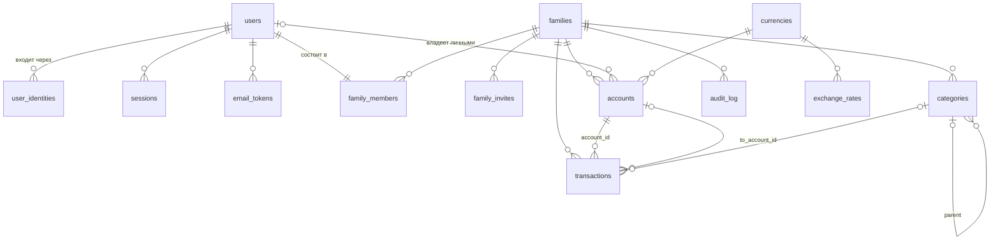

# Модель данных

Схема: миграции в [`api/migrations/`](../api/migrations/), начальная — [`00001_init.sql`](../api/migrations/00001_init.sql). PostgreSQL 18.



`user_identities` и допускающий NULL `users.password_hash` — задел под вход через Яндекс ID и Google. В MVP этого входа нет (см. requirements.md, раздел 8): таблица пустая, а `password_hash` у каждого пользователя заполнен — это обеспечивает приложение.

`users.terms_accepted_at` и `users.terms_version` — отметка о согласии на обработку ПДн и с пользовательским соглашением (миграция `00003`): когда и с какой версией документов. В схеме допускают NULL, но приложение заполняет их при каждой регистрации. Версия — константа `termsVersion` в `internal/httpapi/auth.go`, сейчас `stub-2026-11-19` (тексты — заглушки).

Регистрация в одной транзакции создаёт пользователя, семью «Семья», членство `owner`, категории по умолчанию (список — в `internal/httpapi/defaultcategories.go`, не в миграции) и сессию. Сессия: `token_hash` = SHA-256 токена из cookie, срок 30 дней со скользящим продлением; подробности — в [api.md](api.md#авторизация).

## Соглашения

- **Идентификаторы** — `uuid` v7 (`uuidv7()`): упорядочены по времени, индексы работают почти как с автоинкрементом, а id не раскрывает количество записей.
- **Деньги** — `bigint` в минимальных единицах валюты (копейки, центы). Валюта операции — валюта её счёта.
- **Время** — `timestamptz`. Дата операции — `date` без времени, «сегодня» считается в часовом поясе пользователя.
- **`updated_at`** обновляет приложение в UPDATE-запросах, триггеров нет.
- **E-mail** хранится в нижнем регистре (проверяется `CHECK`).
- **Токены** (сессии, письма, приглашения) хранятся только как SHA-256. Сам токен есть только у пользователя.

## Ключевые решения

### Изоляция семей (multi-tenancy)
Все доменные таблицы содержат `family_id`. Операции ссылаются на счета и категории **составными ключами** `(family_id, account_id)`, поэтому БД сама не даст привязать операцию к счёту чужой семьи. Но фильтрация `WHERE family_id = $1` в каждом запросе всё равно обязательна: составной ключ защищает от рассогласования, а не от чтения чужих данных.

### Видимость счетов
`accounts.owner_user_id IS NULL` — общий счёт, иначе личный. Условие видимости для пользователя `U`:

```sql
a.owner_user_id IS NULL OR a.owner_user_id = U
```

Операция видна, если виден её `account_id` **или** `to_account_id`. Перевод «личный → общий» другие участники видят через общий счёт, а название личного счёта приложение им не отдаёт («Пополнение от Ивана»).

### Одна таблица операций, суммы со знаком
Расход, доход, перевод и корректировка хранятся в `transactions`. Допустимые сочетания полей задаёт `CHECK transactions_kind_shape`. Знак `amount` — это изменение остатка `account_id`. Поэтому остаток считается простой суммой без `CASE` по типам:

```sql
initial_balance
  + SUM(amount)    WHERE account_id    = :id
  + SUM(to_amount) WHERE to_account_id = :id
```

API принимает и отдаёт **положительные** суммы, знак расставляет сервисный слой.

Обмен валют — обычный `transfer` между счетами в разных валютах: `-amount ≠ to_amount`, фактический курс = `to_amount / -amount`.

### Удаление
| Сущность | Как удаляется |
|---|---|
| Операция | мягко (`deleted_at`) |
| Счёт | архив (`archived_at`); удалить физически можно только без операций |
| Категория | архив; удаление — через слияние (операции переносятся, затем `DELETE`) |
| Семья, пользователь | физически, каскадом |

`accounts.owner_user_id` намеренно **без** `ON DELETE`. Удалить пользователя с личными счетами БД не даст. Приложение сначала должно явно решить их судьбу, иначе при `SET NULL` личные счета стали бы общими и видимыми всем.

### Что вычисляется, а не хранится
- Остатки счетов — суммой по операциям (при ~10 тыс. операций в семье это быстро; кэш добавим, когда понадобится).
- «Последний использованный счёт» и «частые категории» — по последним операциям пользователя (`created_by`).

## Известные вопросы

1. **Удаление аккаунта участника с переводами «личный ↔ общий».** Если удалить такие операции вместе с личным счётом, задним числом изменится остаток общего счёта. Вариант: превращать общую сторону в доход/расход с категорией «Перевод от участника» перед удалением.
2. **Журнал изменений и приватность.** Записи `audit_log` по операциям на личных счетах нужно фильтровать по тем же правилам видимости, что и сами операции.
3. **Соответствие типа категории и операции** (расходная категория у расхода) проверяется в приложении, не в БД.
